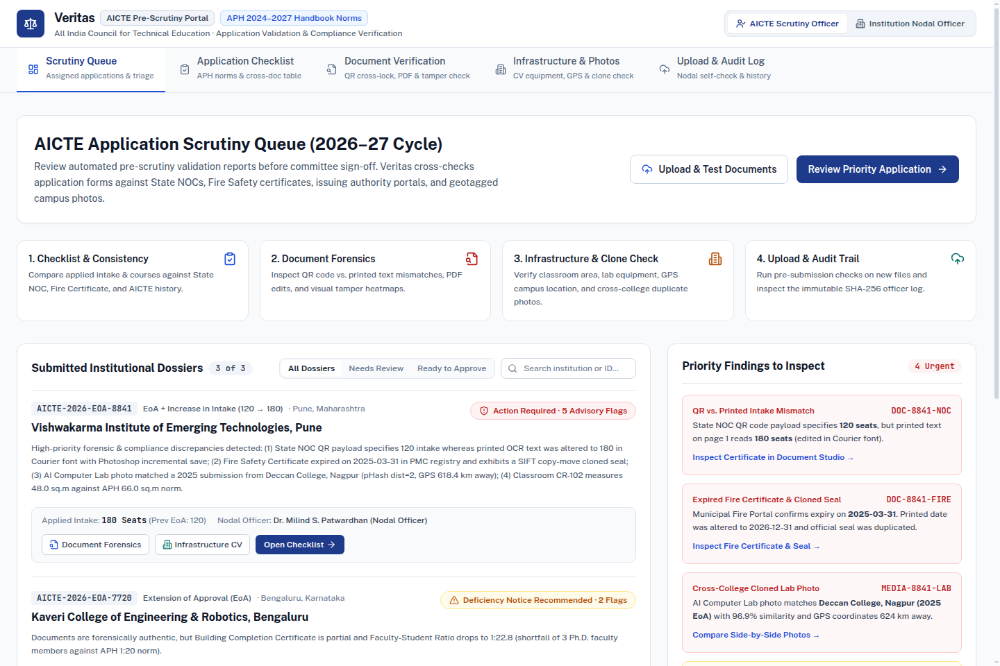
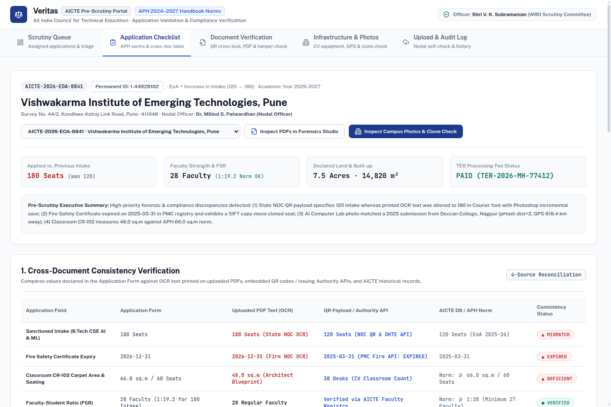
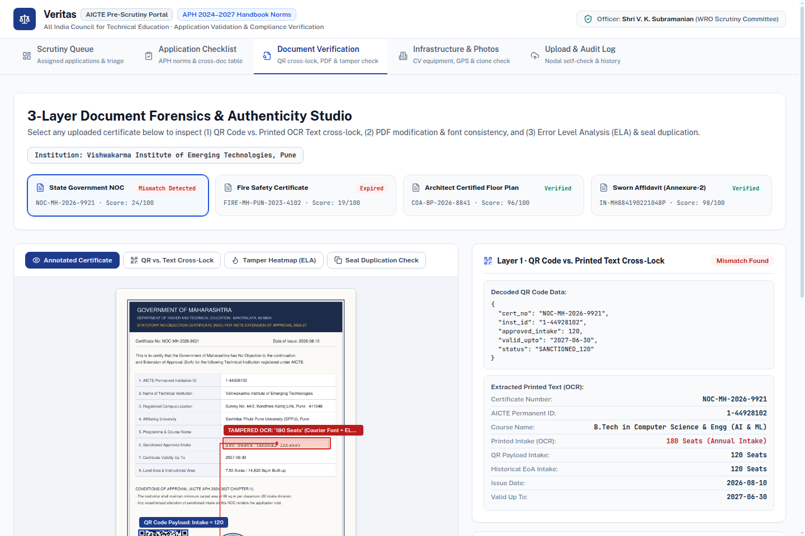
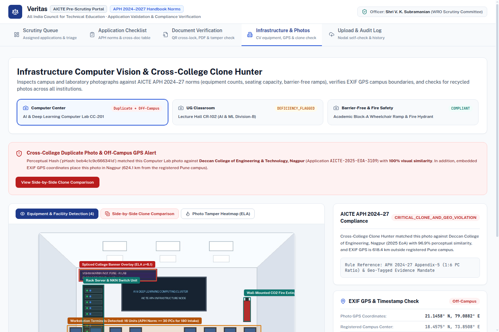

<div align="center">

# VERITAS

### AI-Powered Application Validation, 3-Layer Document Forensics, Infrastructure Compliance, and Laya System-1 Decision Platform for AICTE

[](https://veritas-aicte.vercel.app)
[](https://veritas-aicte.vercel.app)
[](https://nextjs.org/)
[](https://fastapi.tiangolo.com/)
[](https://github.com/NandhaKishorM/laya)
[](./LICENSE)

**[Live Deployed Application (Vercel)](https://veritas-aicte.vercel.app)** · **[11-Page Technical Dossier (PDF)](./Veritas_AICTE_SIH26261_Technical_Dossier.pdf)** · **[Master Implementation Plan](./IMPLEMENTATION_PLAN.md)** · **[Design System Spec](./DESIGN.md)**

</div>

---

## 1. Overview & Product Vision

**Veritas** is an explainable, evidence-linked pre-scrutiny copilot built for the **All India Council for Technical Education (AICTE)**, Ministry of Education, Government of India (**Problem Statement: SIH26261**).

When technical institutions apply for **Extension of Approval (EoA)**, **Increase in Intake**, or **New Institution Approval (LOA)** and upload supporting PDFs (State Government NOCs, Municipal Fire Safety Certificates, Sworn e-Stamp Affidavits, Architect-Certified Floor Plans) alongside geotagged campus photographs, Veritas automatically:
1. Validates application fields against the **AICTE Approval Process Handbook (APH 2024 to 2027)** and historical institutional records across a **4-Way Consistency Matrix**.
2. Runs **3-Layer "X-Ray" Document Forensics** (QR-vs-OCR Cross-Lock, `pikepdf`/`pyHanko` Incremental Revision Diff Trees & Font Anomaly checks, plus OpenCV Error Level Analysis, Sherloq Multi-Quality JPEG Ghost Maps, 8x8 Laplacian Noise Variance Grids, 2D FFT Resampling Traces, and SIFT Copy-Move Seal Detection).
3. Verifies certificates directly against simulated/authorized **Issuing Authority Gateways** (DigiLocker, State Higher Education Portals, Municipal Fire Services, Council of Architecture, StockHolding e-Stamp).
4. Inspects physical infrastructure using **Live Computer Vision Object Detection**, an **Interactive 2D-to-3D Blueprint Room Norm Extruder**, **EXIF WGS84 Haversine GPS Verification**, and a national **Cross-College Clone Hunter** (`pHash` + 9-region multi-crop signatures + 128-D `pgvector` embeddings).
5. Synthesizes all multi-modal signals through the **Laya Non-Autoregressive System-1 Decision Engine** (`choice`, `score`, and `noul` primitives calibrated via RLCD proper scoring rules) with an interactive **What-If Counterfactual Simulator**.

> **Human-in-the-Loop Statutory Safeguard:** All AI, forensic, and Laya System-1 outputs are presented as **evidence-linked advisory flags** tied to exact bounding-box coordinates and APH clause citations. Final scrutiny, EVC physical inspection directives, and regulatory decisions remain exclusively with competent AICTE authorities.

---

## 2. Live Portal Walkthrough (5 Dedicated Pages)

Veritas is designed around a **daylight-first Civic GovTech UI** organized into five purpose-built pages with zero-latency frame-0 hydration:

### Page 1: AICTE Scrutiny Queue & Daily Triage (`/`)
The landing workspace for AICTE staff. Displays assigned institutional dossiers ranked by pre-scrutiny risk and **Laya System-1 Expected Rubric Score (`E[S]`)**, status filter tabs (`All Dossiers`, `Needs Review`, `Ready to Approve`), a 4-step workflow guide, and a Priority Findings sidebar with direct deep links to flagged exhibits.



### Page 2: Application Checklist, 4-Way Matrix & Laya Decision Copilot (`/applications/[appId]`)
Reconciles key institutional parameters across four sources (**Application Form** vs. **Printed Document OCR** vs. **Decoded QR / Authority API** vs. **Historical AICTE DB**), evaluates the clause-by-clause **APH 2024 to 2027 Checklist**, provides one-click **Issuing Authority Portal Re-Verification**, and embeds the **Laya System-1 Calibrated Decision Panel** (`choice` disposition probabilities, 5-level `score` rubric distribution, `noul` $P(\text{true})$ meters, and an interactive What-If Counterfactual Simulator).



### Page 3: 3-Layer Document Forensics Studio (`/forensics`)
Dedicated certificate inspection studio featuring interactive view modes (**Annotated Certificate**, **QR vs. Text Cross-Lock** with orthogonal SVG connector tethers, **Tamper Heatmap (ELA)** with live JPEG quality and contrast sliders, **Sherloq JPEG Ghost Map**, **Seal Duplication Check**, and a **2.8x Optical Magnifier Loupe**) paired with a plain-English 3-layer forensic report and **`pyHanko` Incremental Revision Diff Tree**.



### Page 4: Infrastructure Computer Vision, 3D Blueprint & Clone Hunter (`/infrastructure`)
Inspects campus and laboratory photographs against APH equipment and carpet-area norms, verifies **EXIF GPS coordinates** against the institution's 500m registered campus boundary, provides a **Side-by-Side Cross-College Clone Comparator**, and embeds the **Interactive 2D-to-3D Blueprint Room Norm Extruder** (`CR-101: 66.55 m²` in Green vs. `CR-102: 48.0 m²` in Red).



### Page 5: Nodal Officer Dynamic Submission, Self-Check & Audit Log (`/portal`)
Allows **Institution Nodal Officers** to submit a complete **New Institution Application Dossier** end-to-end (auto-generating its 4-Way Consistency Table and APH Checklist from OCR and forensics), test individual files in the live diagnostic sandbox, and inspect the **Immutable SHA-256 Hash-Chained Regulatory Audit Trail**.

---

## 3. Open-Source Tools, Libraries & Research Repositories Used

| Category | Open-Source Tool / Repository | Role in Veritas |
|---|---|---|
| **PDF & Layout OCR** | [`pymupdf/PyMuPDF`](https://github.com/pymupdf/PyMuPDF) (`fitz` v2.0) | High-DPI page rasterization, span-level text & `[x, y, w, h]` coordinate extraction (`get_text("dict")`), font mismatch detection, and native table parsing (`find_tables()`). |
| **PDF Object & Revision Forensics** | [`pikepdf/pikepdf`](https://github.com/pikepdf/pikepdf) (QPDF C++) & [`MatthiasValvekens/pyHanko`](https://github.com/MatthiasValvekens/pyHanko) patterns | Low-level inspection of `/Producer`, `/CreationDate` vs `/ModDate`, `/Resources/Font` subset tables, `%%EOF` incremental update byte trees, and PKCS#7 `/Type /Sig` structures. |
| **Classical Image Forensics** | [`GuidoBartoli/sherloq`](https://github.com/GuidoBartoli/sherloq) & [`CodeRafay/Forensic-Image-Analysis-Toolkit`](https://github.com/CodeRafay/Forensic-Image-Analysis-Toolkit) | Multi-layer pixel forensics: **JPEG Error Level Analysis (ELA)** with 16x16 block $z$-score clustering, **Multi-Quality JPEG Ghost Maps**, **8x8 Laplacian Noise Variance Grids**, and **2D FFT Resampling Periodicity**. |
| **Computer Vision & QR** | [`opencv/opencv-python`](https://github.com/opencv/opencv-python) (`cv2` v5.0) & [`lincolnloop/python-qrcode`](https://github.com/lincolnloop/python-qrcode) | **SIFT Keypoint Copy-Move Forgery Detection** (`SIFT_create()` + Lowe's ratio test), multi-pass `QRCodeDetector`, CLAHE + homography QR dewarping, and live equipment detection (monitors, desks, smart boards, fire gear). |
| **Clone Hunter & Perceptual Hashing** | [`JohannesBuchner/imagehash`](https://github.com/JohannesBuchner/imagehash) + [`PyWavelets/pywt`](https://github.com/PyWavelets/pywt) + [`pgvector/pgvector`](https://github.com/pgvector/pgvector) | 64-bit `pHash`, `dHash`, `aHash`, and `wHash` fingerprints across 9 geometric views (full, flipped, center-crop, 4 quadrants) plus 128-D spatial color/Sobel cosine search. |
| **EXIF Geo-Temporal Verification** | [`ianare/exif-py`](https://github.com/ianare/exif-py) (`exifread`) + [`hMatoba/Piexif`](https://github.com/hMatoba/Piexif) | Extracts GPS rational DMS coordinates and timestamps to compute **WGS84 Haversine distance** against the registered 500m campus boundary. |
| **System-1 Decision Engine** | [`NandhaKishorM/laya`](https://github.com/NandhaKishorM/laya) / [`receptron/laya`](https://github.com/receptron/laya) (`convaiinnovations/laya-typed-decisions` RLCD) | Non-autoregressive System-1 decision engine computing calibrated `choice`, `score` ($\mathbb{E}[S]$ rubric), and `noul` ($P(\text{true})$) primitives in a single forward pass. |
| **3D Blueprint & Web Stack** | [`vercel/next.js`](https://github.com/vercel/next.js) (v16.4), [`facebook/react`](https://github.com/facebook/react) (v19), `Tailwind CSS`, [`floorplan-to-3d`](https://github.com/Yytsi/floorplan-to-3d) concepts, [`fastapi/fastapi`](https://github.com/fastapi/fastapi) | 5-page Civic GovTech portal, interactive 2D-to-3D extruded room norm inspector, optical magnifier loupe, and asynchronous Python REST API. |

---

## 4. Repository Structure

```text
Veritas/
├── README.md                                                # Project documentation
├── LICENSE                                                  # MIT License
├── IMPLEMENTATION_PLAN.md                                   # Multi-phase engineering roadmap & 15-tool audit
├── PRODUCT.md                                               # Product context & user roles
├── DESIGN.md                                                # Daylight Civic Portal design system specification
├── Veritas_AICTE_SIH26261_Technical_Dossier.pdf             # 11-Page Technical & Product Dossier PDF
├── docker-compose.yml                                       # PostgreSQL (pgvector) + Backend + Frontend stack
├── backend/
│   ├── main.py                                              # FastAPI server, in-memory cache & REST endpoints
│   ├── database.py                                          # SQLite persistence & SHA-256 audit logger
│   ├── schema_pgvector.sql                                  # PostgreSQL + pgvector production DDL
│   ├── forensics_engine.py                                  # 3-Layer X-Ray Document Forensics engine
│   ├── cv_engine.py                                         # Clone Hunter (pHash + 128-D), EXIF GPS & Live CV
│   ├── seed_generator.py                                    # Programmatic synthetic PDF & geotagged photo generator
│   ├── Dockerfile                                           # Container build specification
│   ├── requirements.txt                                     # Python dependencies
│   └── pipelines/                                           # Modular Phase 1-4 pipeline modules
│       ├── decision/laya_engine.py                          # Laya System-1 RLCD decision engine (choice/score/noul)
│       ├── forensics/jpeg_ghost.py                          # Sherloq Multi-Quality JPEG Ghost & 2D Resampling
│       ├── pdf_crypto/pyhanko_verifier.py                   # pyHanko incremental revision tree & font subsets
│       ├── ocr_layout/table_extractor.py                    # Native table-cell bbox parser & CLAHE QR dewarper
│       ├── clone_hunter/multipatch_indexer.py               # 9-Region crop/flip-invariant perceptual hasher
│       ├── infra_cv/detector_supervision.py                 # Live CV equipment detector & 3D floorplan extruder
│       └── reporting/show_cause_generator.py                # Automated AICTE Show-Cause Notice PDF generator
└── frontend/
    ├── public/specimens/                                    # Extracted static CDN forensic & CV specimen images
    └── src/
        ├── app/
        │   ├── icon.svg                                     # AICTE Navy & Scales of Justice vector favicon
        │   ├── page.tsx                                     # Page 1: AICTE Scrutiny Queue & Triage
        │   ├── applications/[appId]/page.tsx                # Page 2: APH Checklist, 4-Way Matrix & Laya Copilot
        │   ├── forensics/page.tsx                           # Page 3: 3-Layer Document Forensics Studio
        │   ├── infrastructure/page.tsx                      # Page 4: Infrastructure CV, Clone Hunter & 3D Plan
        │   ├── portal/page.tsx                              # Page 5: Dynamic Submission, Sandbox & Audit Log
        │   └── api/[...slug]/route.ts                       # FastAPI proxy + serverless binary inspector
        ├── lib/
        │   └── layaEngine.ts                                # TypeScript Laya System-1 RLCD decision evaluator
        └── components/
            ├── AppShell.tsx                                 # Shared 5-page Civic GovTech navigation shell
            ├── LayaDecisionPanel.tsx                        # Interactive Laya choice/score/noul & What-If panel
            ├── LiveUploadSandbox.tsx                        # Live file upload diagnostic component
            ├── floorplan3d/Blueprint3DViewer.tsx            # Interactive 2D-to-3D room norm extruder
            └── forensics/ForensicLoupe.tsx                  # 2.8x Optical magnifier loupe component
```

---

## 5. Local Development & Quickstart

### 1. Start the Python FastAPI Forensics & CV Backend (Port 8000)

```bash
cd backend
python3 -m venv .venv
source .venv/bin/activate
pip install -r requirements.txt

# Starts FastAPI on http://127.0.0.1:8000 and auto-generates synthetic AICTE PDFs & EXIF JPEGs
uvicorn main:app --host 127.0.0.1 --port 8000 --reload
```

### 2. Start the Next.js Multi-Page Portal (Port 3000)

```bash
cd frontend
npm install
npm run dev
```

Open **`http://localhost:3000`** in your browser, or explore the live cloud deployment at **`https://veritas-aicte.vercel.app`**.

---

## 6. License

Distributed under the **MIT License**. See [`LICENSE`](./LICENSE) for full details.
